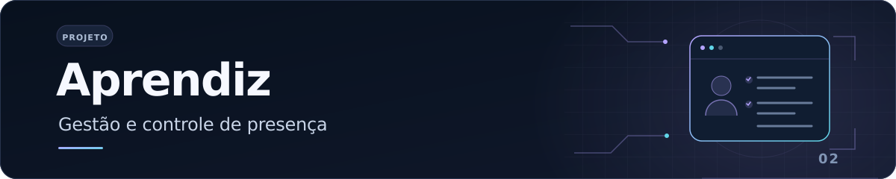
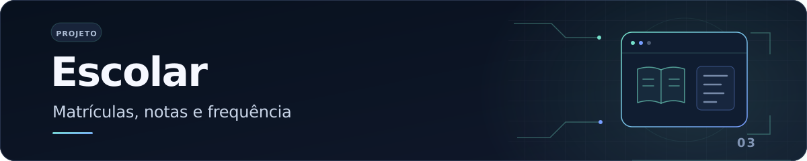

  <picture>
    <source media="(max-width: 640px)" srcset=".github/assets/profile-cover-mobile.svg" />
    
  </picture>
    
  
  &nbsp;
  

## Back-end na prática

Sou estudante de **Sistemas para Internet na UNCISAL** e do curso **Técnico em Informática para Internet no Senac**, ambos em andamento.

Desenvolvo meus conhecimentos em **PHP, Laravel e MySQL** por meio de aplicações de gestão. Nos projetos, pratico arquitetura MVC, Eloquent ORM, autenticação, controle de acesso, validação de dados e testes automatizados.

**Busco estágio ou oportunidade como jovem aprendiz em desenvolvimento back-end.** Tenho disponibilidade no turno da manhã.

## Tecnologias que uso nos projetos

| Área | Tecnologias | Aplicação prática |
| :--- | :--- | :--- |
| **Back-end** | PHP · Laravel · Eloquent · Blade | Regras de negócio, autenticação e controle de acesso |
| **Dados** | MySQL · SQL | Modelagem relacional, migrations e consultas |
| **Qualidade** | Git · PHPUnit | Versionamento e testes de funcionalidades e permissões |
| **Interfaces** | HTML · CSS · JavaScript | Páginas e formulários para aplicações web |

React, TypeScript, Inertia e Tailwind CSS também fazem parte do **TrainOps**.

## Projetos selecionados

<a href="https://github.com/amancio-dev/trainops">
  <picture>
    <source media="(max-width: 640px)" srcset=".github/assets/project-trainops-mobile.svg" />
    
  </picture>
</a>

**Laravel · React · TypeScript · MySQL**

Gestão de colaboradores, cursos, treinamentos e orçamento anual. Inclui autenticação, permissões, pesquisa, filtros, paginação e exportação CSV.

[Explorar código, arquitetura e instalação →](https://github.com/amancio-dev/trainops)

 

<a href="https://github.com/amancio-dev/projetoAprendiz-Laravel">
  <picture>
    <source media="(max-width: 640px)" srcset=".github/assets/project-aprendiz-mobile.svg" />
    
  </picture>
</a>

**PHP · Laravel · MySQL · Blade · PHPUnit**

Modernização de um sistema em PHP para Laravel, com gestão de aprendizes, empresas e instituições. Registro de presença com geolocalização, aprovação de pontos, áreas por perfil e testes de autorização.

[Explorar código e evolução do projeto →](https://github.com/amancio-dev/projetoAprendiz-Laravel)

 

<a href="https://github.com/amancio-dev/sistemaEscolar">
  <picture>
    <source media="(max-width: 640px)" srcset=".github/assets/project-escolar-mobile.svg" />
    
  </picture>
</a>

**PHP · Laravel · MySQL · Blade · JavaScript**

Gestão acadêmica com cadastros, matrículas, notas, frequência e chamada em lote. Possui perfis de acesso, portal individual do aluno e testes de controle de acesso e integridade dos registros.

[Explorar funcionalidades, código e testes →](https://github.com/amancio-dev/sistemaEscolar)

<strong>Outros projetos e a evolução dos meus estudos</strong>

- [Ficha Amputados](https://github.com/amancio-dev/fichaAmputados)
- [Projeto Aprendiz em PHP](https://github.com/amancio-dev/projetoaprendiz)

## Formação e desenvolvimento

- **UNCISAL:** Tecnologia em Sistemas para Internet — em andamento.
- **Senac:** Técnico em Informática para Internet — em andamento.
- **Foco atual:** aprofundar PHP, Laravel, bancos de dados e testes, aprendendo com a construção e manutenção dos projetos.

## Contato

Para conversar sobre **estágio ou jovem aprendiz em desenvolvimento PHP**, fale comigo pelo [LinkedIn](https://www.linkedin.com/in/amancio-dev/) ou pelo [e-mail](mailto:andreamancio0751@gmail.com).

  André Amancio · <a href="https://github.com/amancio-dev">@amancio-dev</a> · Alagoas, Brasil

